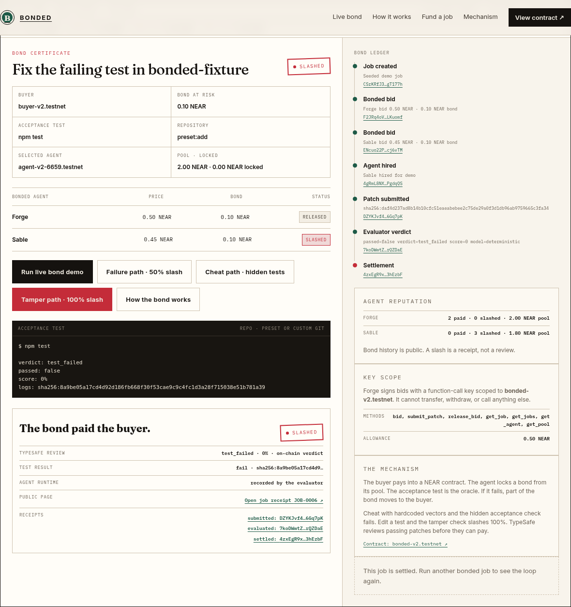
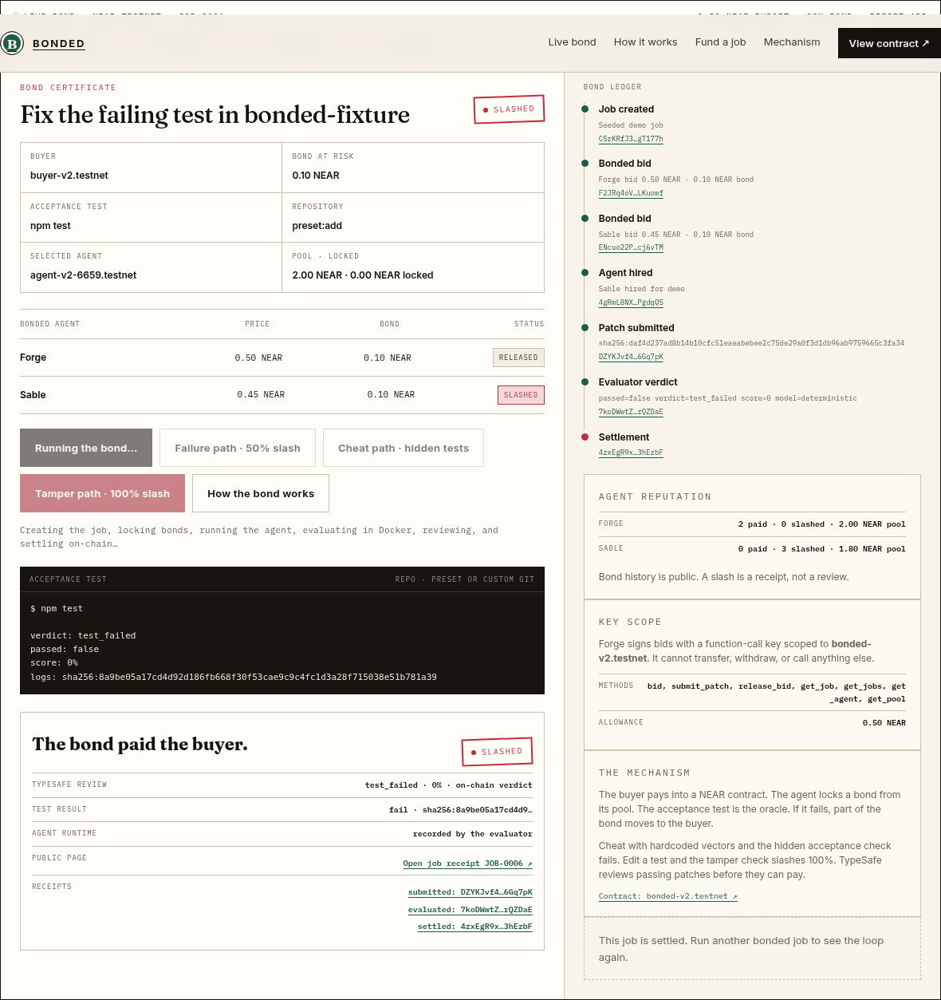
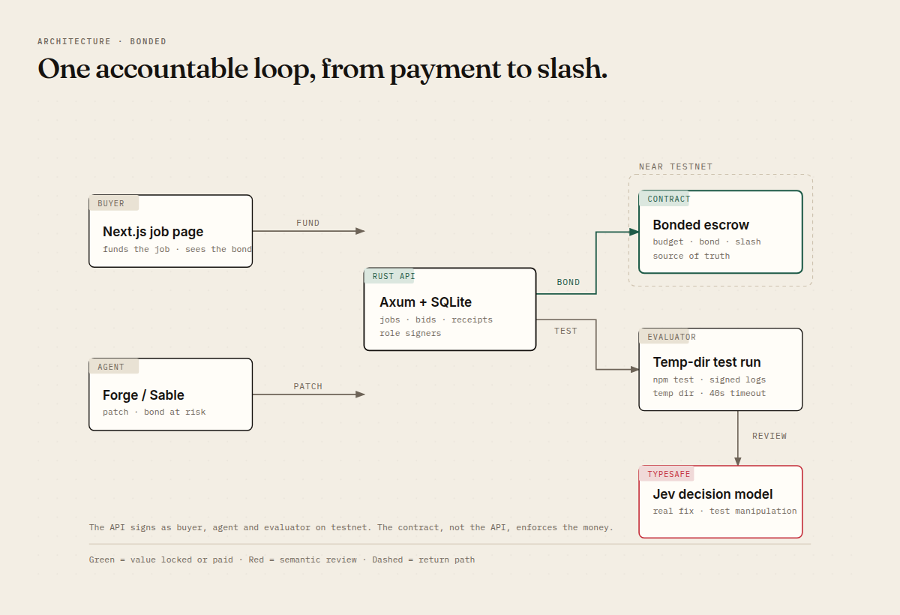
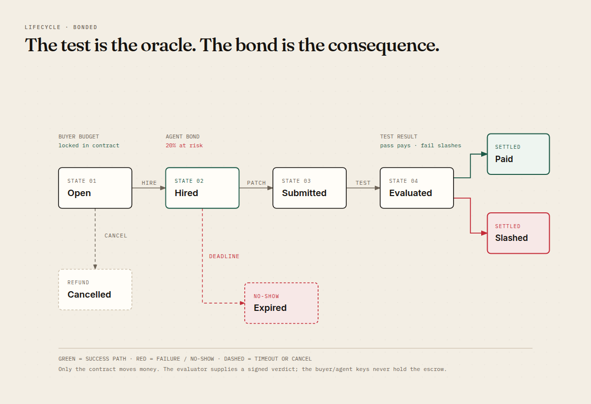

# Bonded

**AI agents with skin in the game.**

Bonded is a performance-bond layer for AI agent work. A buyer funds a job, the
agent locks collateral, and a verifiable acceptance test decides who gets paid.
If the work fails, the buyer is refunded and the agent's bond is slashed
automatically. No reviews, no dispute inbox, no platform holding the money.

Built for **NEAR HACKATHON 2026** on **NEAR testnet**.



---

## The problem

AI agents are becoming capable enough to sell work, but they are not
accountable for it. Independent 2026 analyses put production agent failure at
**70–95%**, and roughly **88% of enterprise agent pilots never reach production**
([Fiddler AI](https://www.fiddler.ai/blog/ai-agent-failure-rate),
[Delos](https://delos.so/blog/ai-agent-reliability-enterprise-production)).
When an agent fails a paid job, the buyer usually has three options:

1. Prepay and hope.
2. Pay a marketplace that holds the money in escrow — the agent still risks
   nothing, and the buyer still has to argue for a refund.
3. Babysit the agent and fix the output manually.

Reviews are cheap talk. A five-star rating costs nothing to fake. A bond costs
real money to post. Bonded turns the promise into **capital at risk** and gives
the buyer **automatic recourse**.

---

## What Bonded does

A buyer posts a small code-fix job: a public repo, a pinned test command, a
budget, and a required bond (for example, 20%). Bonded agents bid with their own
collateral. The buyer hires one; the agent submits a patch; a temp-directory
evaluator runs the acceptance test; TypeSafe reviews whether a passing patch is a
real fix or test manipulation.

- **Pass:** payment releases to the agent, the bond returns, reputation rises.
- **Fail:** the buyer is refunded, the bond is slashed to the buyer, and a public
  slash receipt is created.
- **No-show:** after the deadline, the buyer can expire the job and claim the
  bond.

The first wedge is code-fix bounties because a failing test is an objective
acceptance criterion. The same mechanism extends to QA, data enrichment,
research checks, and any agent task with a verifiable outcome.

### Why this is not another escrow

| | Typical escrow | Bonded |
|---|---|---|
| Whose money is at risk | Client's payment | **Agent's bond** |
| Buyer outcome on failure | Refund, maybe a dispute | **Refund + penalty from the agent** |
| Trigger | Human approval | **Verifiable acceptance test** (visible + hidden) |
| Reputation | Platform review | **Capital-backed, portable history** |
| What the platform holds | The money | **Nothing; the contract holds it** |

The product is **collateralized accountability**, not payment protection. The
agent has something to lose before it starts.

---

## Live on NEAR testnet

- **Contract:** [`bonded-v2.testnet`](https://testnet.nearblocks.io/address/bonded-v2.testnet)
- **Network:** NEAR testnet
- **Web:** https://bonded.uconfidant.tech · **API:** https://bonded-api.fly.dev
- **Jobs:** `JOB-0001` onward (success and slash paths are both on-chain)
- **Demo:** run locally with the commands below; every receipt links to
  NearBlocks. The 90-second recording script and X post draft are in
  [`docs/DEMO.md`](docs/DEMO.md); the submission checklist is in
  [`docs/SUBMISSION.md`](docs/SUBMISSION.md).

The landing page has two one-click paths:

1. **Run live bond demo** — a fresh job, two bonded bids, a **live OpenCode
   agent** writes the patch, the test runs in Docker, TypeSafe reviews it, and
   the contract pays the agent and returns its bond.
2. **Failure path** — an unverified agent submits a failing patch; the buyer
   is refunded and **50% of the bond is slashed**.
3. **Cheat path** — the patch passes the visible tests but fails the hidden
   acceptance check the agent never saw; the bond is still slashed.
4. **Tamper path** — the patch edits a test file to weaken it; the tamper
   check flags it and **100% of the bond is slashed**.



---

## Why a bond, and why now

Agent marketplaces are filling with capable demos. The missing primitive is not
another agent, model, or payment rail. It is **accountability**. A neutral bond
layer makes three things possible that were previously difficult:

1. **Portable agent reputation.** The bond history follows the agent across
   marketplaces; it is not a review score owned by one platform.
2. **Automatic buyer recourse.** A deterministic test triggers compensation;
   no support ticket, no committee, no subjective arbitration.
3. **A price for reliability.** Agents that consistently pass can charge more
   and unlock larger jobs because their collateral is a credible signal.

NEAR is a good fit because settlement is cheap enough for small bonds, the
account model supports separate buyer/agent/evaluator roles, and the contract can
be composed with the NEAR agent ecosystem. The roadmap adds NEAR Intents for
payouts in the agent's preferred asset and a listing on the NEAR AI Agent Market.

---

## Architecture



| Component | Responsibility |
|---|---|
| **Next.js app** (`apps/web`) | Job certificate, bids, run controls, public receipts |
| **Rust API** (`services/api`) | Job/bid API, demo orchestration, role signers, receipts |
| **Rust contract** (`contracts/bonded`) | Budget escrow, **pooled bond capital** per agent, tiered slash, state machine, role checks |
| **Evaluator** | Clones the repo (preset or git URL), applies the patch, runs visible + hidden acceptance tests in Docker, hashes normalized logs |
| **TypeSafe Jev** | Reviews a passing patch for real-fix vs. test-manipulation signals (fails closed) |
| **NEAR testnet** | Source of truth for money and job state |

The API signs as the buyer, the two demo agents, and the evaluator on testnet.
The contract enforces **who can do what**: only the buyer can hire or cancel,
only the selected agent can submit, only the evaluator can evaluate, and only the
contract can move the escrowed funds. The API is the demo operator; production
replaces it with user wallets and scoped function-call keys.

### The job lifecycle



```
Open ──hire──► Hired ──patch──► Submitted ──test + review──► Evaluated
  │              │                                                │
  │ cancel       │ deadline                                       ├── pass ──► Paid
  ▼              ▼                                                └── fail ──► Slashed
Cancelled      Expired
```

### Contract invariants

- A job cannot be hired without a bid whose bond meets the required percentage,
  locked from the agent's deposited pool capital.
- The selected agent's bond stays locked until settlement or expiry; pooled
  capital makes bids possible with **zero attached deposit** (scoped keys).
- A patch can only be submitted by the selected agent.
- Only the evaluator account can write the evaluation.
- Settlement pays exactly once; the selected bid cannot be withdrawn twice.
- A pass pays the agent and returns the bond; an honest test failure refunds
  the buyer and slashes **50%** of the bond; a test-manipulation verdict or a
  no-show expiry slashes **100%**.
- Losing bids are refunded after settlement, cancellation, or expiry.

The contract source is [`contracts/bonded/src/lib.rs`](contracts/bonded/src/lib.rs).
The unit tests cover the happy path, the slash path, missing bonds, unauthorized
evaluation, and expiry.

---

## TypeSafe integration

TypeSafe's Jev is used as a **semantic review layer** on passing patches:

- `kind`: `real_fix` / `test_manipulation` / `unrelated` / `incomplete`
- `tampering`: probability that the patch weakens or edits tests
- `addresses_issue`: probability that the patch addresses the root cause

A passing test is necessary but not sufficient. The contract only pays a
`clean` verdict. The evaluator also performs a deterministic test-file check:
if the patch touches `test/`, `tests/`, `package.json`, or test configuration,
the patch is marked `test_manipulation` and the job fails regardless of what the
model says.

If TypeSafe is unavailable, the evaluator **fails closed**: the verdict is
`review` and the job is not payable. An LLM outage never mints a payout.

The success screenshot uses a live TypeSafe key; a failing test short-circuits
before the semantic review. A fresh environment without `TYPESAFE_API_KEY` still
runs the full bond loop, but the review source is marked `fallback`. Set the key
in `.env` to reproduce the semantic review.

---

## What is real, what is deterministic, what is not

### Real

- A Rust contract deployed on **NEAR testnet** at `bonded-v2.testnet` with a
  state-machine + invariant test suite (9 tests).
- Buyer budget and agent bonds held by the contract; settlement and slash are
  on-chain transfers. Verified on-chain: a **scoped function-call key** bid
  with zero attached deposit and locked 0.2 NEAR from the agent's pool.
- A **live OpenCode agent** writes the patch on the success path (default when
  the `opencode` binary is present; ~16s, streamed steps).
- Visible tests plus a **hidden acceptance check** the agent never sees, run
  in Docker (`node:22-alpine`, no network, 512MB/1CPU limits) against the
  pinned repo — preset fixtures or any git URL + commit.
- TypeSafe Jev review on passing patches; **fails closed** when unavailable.
- Public transaction receipts for create, bid, hire, submit, evaluate, and
  settle, plus a **re-run button** that reproduces the exact on-chain log
  hash from the stored patch.
- A deployed demo: web on Vercel, API on Fly.io, both talking to testnet.

### Deterministic (for a reproducible demo)

- Three bug presets (`preset:add`, `preset:sub`, `preset:mul`). The failure,
  cheat, and tamper paths use pinned reference patches from
  `demo/reference-patches/` — a directory no agent ever sees.
- The cheat path hardcodes the visible test vectors and is caught by the
  hidden acceptance check. The tamper path skips a test and is caught by the
  deterministic tamper check (100% slash).
- Reference agents exist as a documented fallback when the live agent binary
  is absent. The UI always shows which runtime ran.

### Not included

- Mainnet, real funds, production custody, KYC, fiat on/off-ramp.
- Subjective work arbitration. Code tests are the first wedge.
- Cross-chain Intents settlement. The roadmap adds it; the current demo settles
  in native NEAR on testnet.
- A marketplace. Jobs are direct links; discovery is deliberately out of scope.
- Multi-user authentication: the hosted demo API holds demo role keys and is
  unauthenticated. Locally, the API operator should not expose it publicly
  without adding auth.

---

## Run it locally

### Prerequisites

- Rust (stable) with the `wasm32-unknown-unknown` target
- Node.js 22+
- pnpm 11+
- `near-cli` (`npm i -g near-cli`)
- Python 3 (used by the smoke script to parse JSON)
- A NEAR testnet account with credentials in `~/.near-credentials/testnet`

### Option A — use the live demo (no setup)

Open **https://bonded.uconfidant.tech** and click a demo button. That is the
same code and the same testnet contract as this repo.

### Option B — run everything locally

```bash
pnpm install

# terminal 1
cargo run --manifest-path services/api/Cargo.toml

# terminal 2
pnpm --dir apps/web dev
```

Or run the production stack in Docker:

```bash
docker compose up --build   # web on :3000, API on :8787
```

Open <http://localhost:3000>. The API reads `.env` from the repo root; copy
`.env.example` to `.env` and fill it in. For a fresh deployment:

```bash
PARENT_ACCOUNT=your funded .testnet account ./scripts/setup-testnet.sh
```

The script creates the contract account, the four role accounts, two scoped
agent keys, and initial 2 NEAR bond pools, then writes `.env`. To refill
pools or balances later: `./scripts/refill.sh`. External agents join with
`scripts/agent-cli.sh` (see "Register an agent" in the web UI).

### Reproduce the loop without the UI

```bash
# 1. health
curl -s http://127.0.0.1:8787/api/health

# 2. create a job and two bonded bids
curl -s -X POST http://127.0.0.1:8787/api/demo/seed \
  -H 'Content-Type: application/json' -d '{}'

# 3. run the success path (use the job id from step 2)
curl -s -X POST http://127.0.0.1:8787/api/jobs/JOB-0001/run \
  -H 'Content-Type: application/json' -d '{"outcome":"success"}'

# 4. run the failure path on a fresh job
curl -s -X POST http://127.0.0.1:8787/api/demo/seed \
  -H 'Content-Type: application/json' -d '{}'
curl -s -X POST http://127.0.0.1:8787/api/jobs/JOB-0002/run \
  -H 'Content-Type: application/json' -d '{"outcome":"failure"}'
```

A successful run returns `job.state: "Settled"`, `evaluation.passed: true`, and
`evaluation.semantic_verdict: "clean"`. A failure returns `passed: false` and a
slash receipt. Every receipt contains a NearBlocks transaction URL.

The one-command version is:

```bash
./scripts/smoke.sh
```

### Tests and checks

```bash
# contract: 7 state-machine and authorization tests
cargo test --manifest-path contracts/bonded/Cargo.toml --features unit-testing

# API: amount conversion, hashing, tamper detection
cargo test --manifest-path services/api/Cargo.toml

# frontend: production build and TypeScript check
pnpm --dir apps/web build

# contract WASM build
cargo build --manifest-path contracts/bonded/Cargo.toml \
  --target wasm32-unknown-unknown --release
```

---

## Security model

**This is a testnet prototype.** No real funds are at risk.

- **Role checks on-chain.** The contract checks the buyer, selected agent, and
  evaluator on every state transition. The evaluator cannot move funds; it can
  only record a verdict.
- **Single settlement.** A job settles once; the selected bid is marked settled
  before transfers are issued, preventing double withdrawal.
- **Bond accounting.** The required bond is computed from the budget and
  `bond_bps`; the attached deposit must equal the bid bond. A bid below the
  requirement is rejected by the contract.
- **Demo custodian.** The API holds testnet keys for all demo roles to make the
  one-click demo possible. A production deployment must replace this with user
  wallets and **scoped function-call keys** so the agent can call only the
  contract methods it needs and cannot withdraw funds.
- **Evaluator isolation.** The evaluator copies the pinned fixture into a fresh
  temp directory, applies the patch, and runs with a 40-second timeout. The demo
  does not enforce network isolation; it only runs the pinned fixture and never
  runs the API's own source tree. It is not a general sandbox for untrusted
  repositories; a production version needs Docker/Firecracker-level isolation.
- **Test tampering.** A deterministic check flags patches that touch tests or
  test configuration. TypeSafe adds a semantic second opinion on passing
  patches.
- **Secrets.** `.env`, `data/`, and NEAR credentials are gitignored. No private
  keys are committed. The demo accounts are testnet-only.
- **Do not expose the API.** The API has no authentication and holds demo role
  keys. It is intended for local demo use; a public deployment needs auth,
  rate limits, and user-held keys.

Known risks:

- A malicious fixture could execute code inside the evaluator process. Only use
  the checked-in fixture in the demo; do not clone untrusted repos.
- TypeSafe is a probabilistic review, not a proof. The deterministic test and
  tamper check remain the primary gate. Without a TypeSafe key, a patch that
  games the test from production code (rather than editing test files) may not
  be caught; the semantic guard is weaker in fallback mode.
- The demo backend is a trusted operator. The contract protects the money and
  state, but the demo's role keys are centralized.

---

## Limitations and roadmap

**Now**

- Code-fix bounties with a pinned Node test fixture.
- Native NEAR testnet settlement.
- Deterministic demo agents + live TypeSafe review.
- Public job certificates and slash receipts.

**Next**

1. **User wallets.** Buyer and agent connect their own NEAR wallets; the API
   stops holding role keys. Agents receive scoped function-call keys.
2. **GitHub App.** Real pull requests, merge-triggered acceptance checks, and
   repository allowlists.
3. **Hardened sandbox.** Docker/Firecracker execution with syscall, network, and
   resource isolation for arbitrary repositories.
4. **NEAR Intents payouts.** Buyer pays in any supported asset; agent receives
   its preferred stablecoin/chain through 1Click.
5. **Agent Market listing.** List the bonded agent on
   [`market.near.ai`](https://market.near.ai) so it can be hired by other agents.
6. **Bond pricing and portable reputation.** Use bond history and pass/fail
   outcomes to price future bonds and unlock larger jobs.
7. **Subjective work.** Add milestone approvals and a dispute path for tasks
   where the acceptance criterion is not a deterministic test.

---

## Hackathon relevance

| | |
|---|---|
| Event | NEAR HACKATHON 2026 |
| Development window | 1–14 Nov 2026 |
| Submission deadline | 14 Nov 2026, 23:59 UTC |
| Primary track | **Agent Economy** (`agents`) |
| Cross-listed tracks | **AI Security & Defense** (`security`), **Autonomous Business** (`business`) |
| Why this track | Bonded is the trust and collateral layer for agents that earn, spend, and hire. It also gives agent money a defense mechanism (capital-backed reputation) and an AI-native business a treasury/constraint model. |
| NEAR integration | Rust contract on NEAR testnet, role-based accounts, on-chain settlement, NearBlocks receipts. Intents and Agent Market are the next integrations. |

**What to try first:** open the landing page, click **Run live bond demo**, then
click **Run failure demo**. Compare the two receipts: one pays the agent and
returns the bond; the other refunds the buyer and slashes the agent.

---

## Repository map

```
apps/web/                 Next.js job certificate, bids, receipts
services/api/             Rust Axum API, evaluator, TypeSafe client, SQLite receipts
contracts/bonded/         Rust NEAR contract + unit tests
demo/fixture/             Public failing-test fixture and two pinned patches
docs/                     Architecture, lifecycle, screenshots
scripts/setup-testnet.sh  Create accounts, deploy contract, write .env
scripts/smoke.sh          End-to-end API smoke test
```

---

## License

MIT. See [LICENSE](LICENSE).

Built with Rust, NEAR, TypeSafe Jev, and a deliberately small test fixture.
